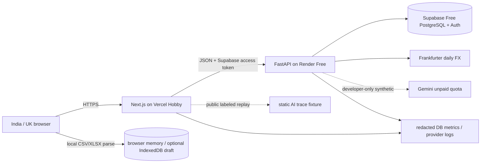
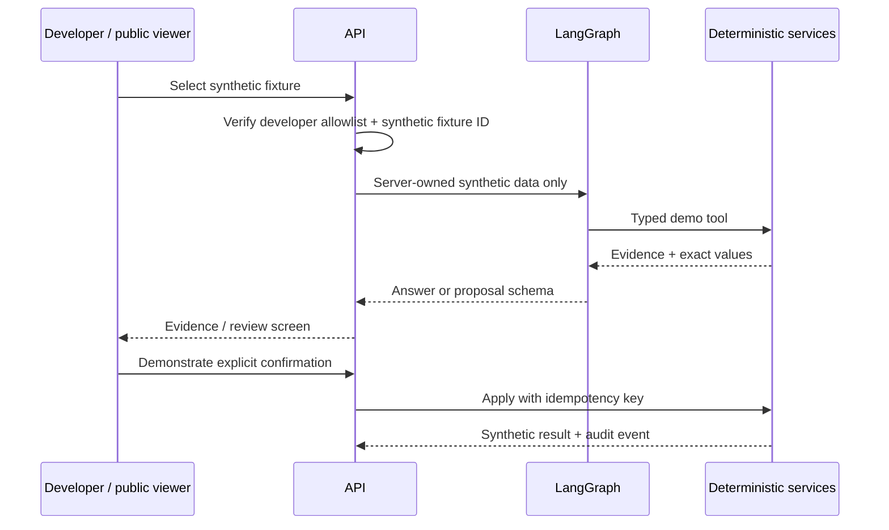

# System architecture

## Constraints and choice

Traffic is small, financial consistency and tenant isolation are strict, and recurring cost must be ₹0. The simplest showcase design is a modular monolith with a static/hybrid web deployment, one minimal sleeping API, and one free PostgreSQL/Auth project. A continuously running worker is unnecessarily expensive and is removed from the showcase architecture.

Deploy web and API separately from one repository. Supabase Auth brokers Google sign-in; FastAPI validates issuer/audience/signature and remains the authorization/business boundary. Modules own tables and service interfaces: identity, users/preferences, transactions, imports, categorization, receipts, groups/splits, budgets, FX, AI demo, chat history, memory, flags, audit and admin. Cross-module writes occur through application services inside a database transaction. Browser code never receives the Supabase service-role or Gemini key.

Chat history, short-term memory and long-term memory are separate capabilities. PostgreSQL stores user-scoped threads/messages, bounded LangGraph checkpoint metadata and explicit memory records. The ledger remains authoritative; memory can only influence presentation or produce a proposal that must pass the ordinary validated service path.

## Critical flows

### Upload

1. Browser validates size, signature/extension and selected parser profile before reading.
2. CSV/XLSX is parsed in a dedicated browser worker; formulas/macros/external links are never executed.
3. User reviews normalized structured candidates locally. Raw bytes remain in browser memory and are discarded on navigation/refresh.
4. Only reviewed structured candidates are sent to FastAPI. The API repeats schema, row and quota validation.
5. Confirmation endpoint locks the batch, rechecks ownership/idempotency and commits atomically.
6. P1 server-side PDF/image endpoints remain disabled until temporary-storage cleanup and private processing are available.

### AI showcase

## API conventions

- `/v1` REST/JSON; OpenAPI is the contract. IDs are opaque UUIDv7/ULID-style identifiers, never sequential public IDs.
- Session-authenticated browser requests use secure `HttpOnly`, `SameSite=Lax` cookies and CSRF protection on mutations.
- Every request carries a generated correlation ID; client-supplied IDs are validated and not trusted.
- Mutation endpoints accept idempotency keys. Responses use a typed problem-details envelope.
- Pagination is keyset-based for transactions/audit events. All list queries include tenant/user predicates in the repository layer.
- Concurrency: optimistic version columns for user-edited aggregates; row locks plus serializable/retry policy for settlement finalization.

## Capacity and performance

The showcase caps CSV/XLSX files at 10 MiB and 10,000 rows, with 20 imports/user/month. Browser work is chunked/off-main-thread. FastAPI uses a small bounded connection pool compatible with Supabase limits. No durable background jobs or 5,000-document guarantee exist at ₹0; long jobs are a paid-deployment capability.

## Failure and degraded modes

| Failure | Behavior |
|---|---|
| Gemini unavailable/disabled | deterministic private features continue; public demo uses a labeled recorded trace |
| FX provider unavailable | use only a cached rate within policy and label stale; otherwise return unavailable; never invent |
| Render sleeping | UI shows “Starting secure API…” and retries once with cancellation; expect about one minute |
| Supabase paused/quota reached | read/write unavailable or database read-only; show maintenance state and operator restore instructions |
| database unavailable | writes fail closed; PWA shows cached read-only state; no false success |
| OIDC unavailable | existing valid sessions may continue to expiry; new sign-ins fail clearly |
| free-tier suspension | fail closed with status page/message; never move sensitive data to an improvised store |

## Availability and recovery

- No availability, RPO or RTO commitment for the ₹0 showcase. Export tooling and periodic owner-initiated encrypted logical backups are required before inviting real users; automatic PITR is a paid upgrade.
- Clearly disclose free-tier pausing, cold starts and possible temporary unavailability.
- Deployment uses expand/migrate/contract changes, health checks and previous-image rollback. Future durable-job schemas must remain backward compatible when a worker is introduced.
