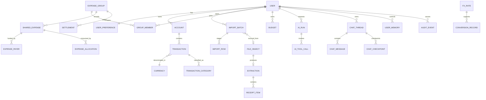

# Financial data model

## Money and time invariants

- Monetary values are `NUMERIC(38, 12)` internally plus ISO 4217 code; application `Decimal` is mandatory. Display/settlement rounds using the currency registry and an explicit mode, normally half-even unless a domain rule says otherwise.
- Preserve `original_amount` and `original_currency`. Converted amounts are derived or stored with immutable rate provenance; they never replace originals.
- Timestamps are UTC instants. A transaction also stores `effective_local_date`, source time-zone/offset when known, and parse provenance so monthly reports are reproducible.
- Financial records use status transitions and compensating/reversal records where auditability matters. Hard deletion is reserved for drafts or privacy erasure policy.

## Entity relationships

## Key records

| Record | Required fields / rules |
|---|---|
| `user` | subject ID, status, created/deletion dates; Google identity is a separate unique `(issuer, subject)` record |
| `user_preference` | country, locale, home/display currency, IANA time zone, formatting choices, notice/terms versions |
| `account` | owner, type, masked label, default currency; manual/import source only in v1 |
| `transaction` | owner/account, original amount/currency, direction, type, effective date, merchant/payee fields, status, source/provenance, version |
| `transaction_category` | category, source (`rule/model/user`), confidence, model/rule version, current flag; history retained |
| `import_batch/row` | parser/profile versions, source hash, staged normalized fields, row confidence/errors, duplicate decision |
| `file_object` | owner/purpose, storage key, hash, media type, scan state, retention choice, expiry; never a public URL |
| `extraction/item` | schema/prompt/model versions, raw structured output, corrected canonical fields, confidence, reconciliation status |
| `expense_group/member` | group currency policy; member links optional user or guest, role/status, membership validity interval |
| `shared_expense` | group, creator, original total/currency, date, state, source receipt, allocation policy version |
| `expense_payer` | participant and exact paid amount; sums equal expense total |
| `expense_allocation` | participant, item/charge, exact owed amount, derivation and residual recipient; sums equal expense total |
| `settlement` | payer/payee, amount/currency, optional conversion agreement, status, reverses ID; partial allowed |
| `fx_rate` | provider, base/quote, rate, observed/as-of/fetched times, type, license attribution, payload hash |
| `conversion_record` | source amount/currency, target, rounded result, rate ID/path, purpose, rounding policy |
| `budget` | owner/category/scope, amount/currency, period and timezone; comparisons use documented conversion policy |
| `ai_run/tool_call` | user, workflow/prompt/model versions, tool name, authorization scope, token/cost/latency, redacted trace, outcome |
| `chat_thread` | owner, title, created/updated timestamps, archived/deleted state; keyset pagination and owner-scoped search |
| `chat_message` | thread/owner, role, bounded text or structured proposal, timestamps, processing state, feedback; attachment references only, never raw files |
| `chat_checkpoint` | thread/owner, workflow version, bounded state/summarization metadata, expiry; no copied ledger rows or raw documents |
| `user_memory` | owner, type, structured value, provenance, created/updated/expiry timestamps, editable/deleted state; explicit remember/update/forget only |
| `audit_event` | append-only actor/action/target/outcome/time/request ID and safe metadata; no raw document or full merchant narrative |

## Isolation

All private rows carry `owner_user_id`; group rows carry `group_id` and are reachable only through an active membership predicate. Repository methods require an authorization context. PostgreSQL row-level security is defense-in-depth after application authorization, not its replacement. Background jobs contain subject and scope and reauthorize when executed.

## Deletion

Deletion state prevents new sessions immediately. A workflow deletes/irreversibly anonymizes private rows, membership links, chat threads/messages, memory records, summaries/checkpoints, objects, AI state and caches, while preserving the minimum non-identifying operational/audit evidence justified by policy. Shared expenses authored by a departing user remain for other members only where necessary, with the user identity pseudonymized and this behavior disclosed before confirmation.
